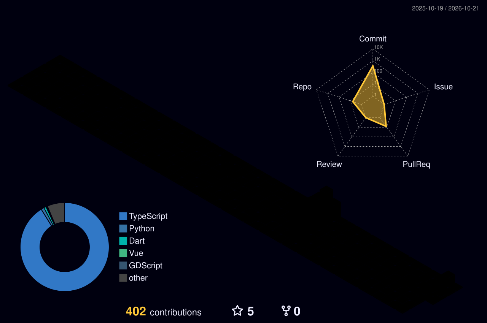

<h1 align="center">Olá, eu sou bnd.sants 👋</h1>
<h3 align="center">Bernardo Santos • Full Stack Developer • Mobile Specialist • Cybersecurity Enthusiast</h3>

  🎓 Formado em <b>Análise e Desenvolvimento de Sistemas</b> e atual estudante de <b>Ciência da Computação</b>. Sou apaixonado por criar arquiteturas robustas, seja no mobile com Flutter ou na web moderna com React e Next.js. Atualmente focado em performance, UX refinada e segurança ofensiva.

---

  
  ### 🚀 Tech Stack & Ferramentas

  #### 📱 Mobile Development
  
  
  
  
  
   

  #### 💻 Frontend Web Moderno
  
  
  
  
  
  
  
   

  #### ☁️ Backend, Dados & DevOps
  
  
  
  
  

   

  #### 🛠️ Tools, Game Dev & Security
  
  
  
  
  

### 🔐 Fundamentos de Cibersegurança

**Foundations of Cybersecurity — Google (Coursera)** · [Ver certificado](https://coursera.org/verify/A42PYGG8E1K)

- Fundamentos de cibersegurança e controles de segurança.
- Noções sobre ataques comuns e seus impactos nas operações de uma organização.
- Ética em segurança e familiaridade com ferramentas usadas por analistas, incluindo conceitos de SIEM.

---

### 🏆 Projetos em Destaque

<table>
  <tr>
    <td width="50%" valign="top">
      <h3 align="center">🍎 Desperdício Zero</h3>
      
Aplicativo mobile para reduzir o desperdício de alimentos por meio do cadastro de produtos e do acompanhamento de sua validade.

      <ul>
        <li><b>Produtos:</b> cadastro, leitura de código de barras e alertas de vencimento.</li>
        <li><b>Receitas:</b> sugestões com integração à API Spoonacular.</li>
        <li><b>Conta:</b> autenticação e dados do usuário via Supabase.</li>
      </ul>
      
<b>Flutter · Dart · Supabase</b>

      
<a href="https://github.com/bnd-sants/desperdicio_zero-master">Ver projeto →</a>

    </td>
    <td width="50%" valign="top">
      <h3 align="center">🎮 NÚCLEO — Tech Gamer</h3>
      
Conceito de e-commerce para componentes de PC, desenvolvido como projeto de portfólio.

      <ul>
        <li><b>Exploração:</b> catálogo, busca, filtros e detalhes de produtos.</li>
        <li><b>Escolha:</b> comparador, montador de setup e carrinho.</li>
        <li><b>Checkout:</b> conclusão demonstrativa, sem cobrança real.</li>
      </ul>
      
<b>Vue 3 · TypeScript · Vite · Pinia</b>

      
<a href="https://github.com/bnd-sants/tech-gamer-ecommerce">Ver projeto →</a>

    </td>
  </tr>
</table>

<table>
  <tr>
    <td valign="top">
      <h3 align="center">🏢 Gravity SaaS</h3>
      
Base para aplicações SaaS multilocatárias, com organizações, autenticação e controle de acesso por função.

      <ul>
        <li><b>Estrutura:</b> isolamento de dados por organização.</li>
        <li><b>Acesso:</b> gestão de membros, convites e permissões.</li>
        <li><b>Stack:</b> Next.js, TypeScript, PostgreSQL e Drizzle ORM.</li>
      </ul>
      
<a href="https://github.com/bnd-sants/SaaS-Multi-tenant">Ver projeto →</a>

    </td>
  </tr>
</table>

---

  ### 📊 Estatísticas
  
  

    
    
  

  
  

    
  

---

### 📫 Contato & Social

  
  

 

### 📚 Atualmente estudando
- 🔐 **Segurança Ofensiva** (Pentest & CTFs)
- 🎮 **Game Development** (Godot Engine)
- 📊 **Power BI** para análise de dados avançada

---

  

